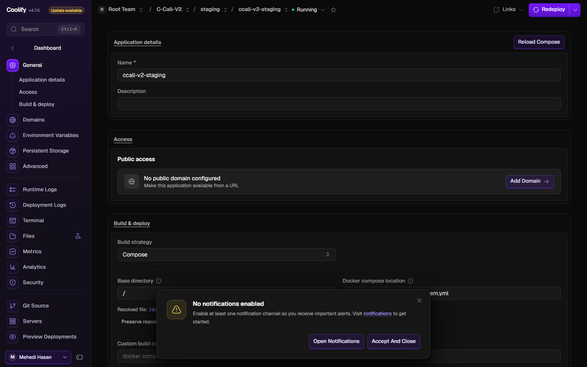
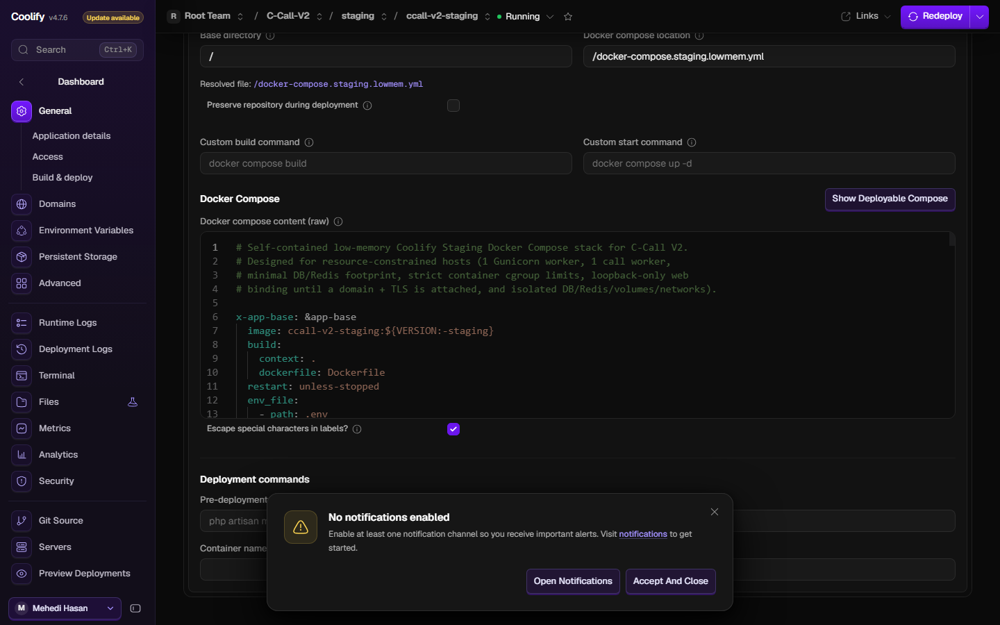
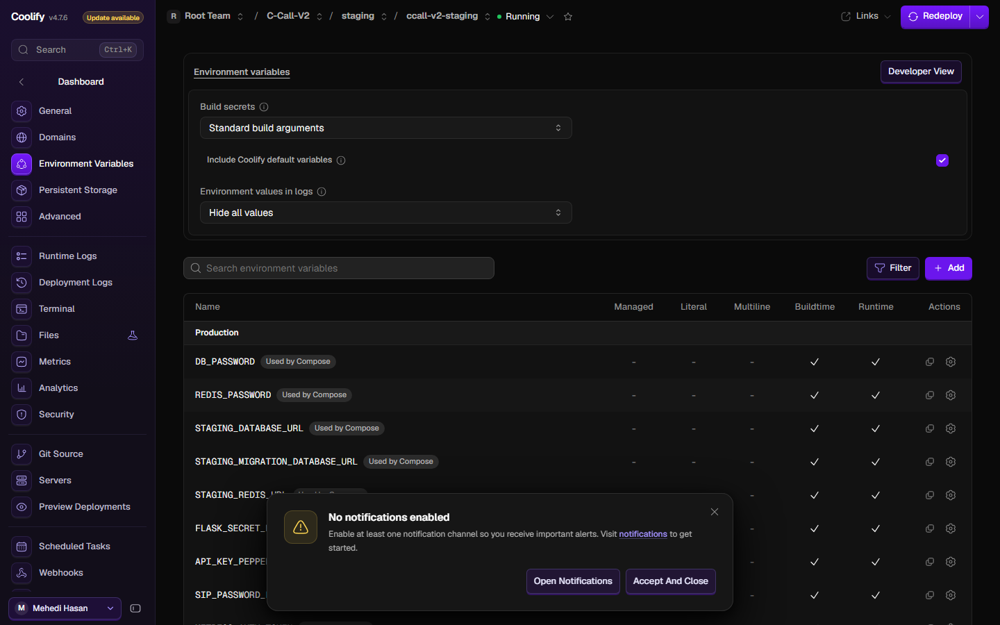

# C-Call V2 — Coolify Deployment Guide

This guide explains how to deploy **C-Call V2** as a strictly isolated project inside **Coolify v4** without affecting any existing applications, databases, or proxy configurations on the same server.

---

## 1. Create an Isolated Coolify Project

1. Log in to Coolify (`http://<YOUR_COOLIFY_IP>:8000`).
2. Go to **Projects -> + Add**.
   - **Name**: `C-Call-V2`
   - **Description**: `C-Call Cloud Telephony, IVR and Ecommerce Order Confirmation Platform`
3. Create or select the target environment (e.g., `staging` or `production`).

> **Isolation Rule:** Always create C-Call inside its own project with its own Docker Compose stack. Never share PostgreSQL, Redis, volumes, or networks with other websites on the server.

---

## 2. Add the Docker Compose Application

1. Inside the `C-Call-V2` environment, click **+ New Resource -> Public Repository** (or GitHub App if private).
2. Enter:
   - **Repository URL**: `https://github.com/abcsoft/C-Call`
   - **Branch**: `feat/c-call-v2-production-foundation`
   - **Build Pack**: `Docker Compose`
   - **Base Directory**: `/`
   - **Docker Compose Location**: `/docker-compose.staging.lowmem.yml` (for low-memory hosts) or `/docker-compose.prod.yml` (for 4+ GiB dedicated hosts)
3. Click **Continue** and select your target server (`localhost` or your attached remote BDIX/VPS server).





---

## 3. Configure Environment Variables

Open the **Environment Variables** tab on the application page and add all required runtime variables (see [SELF_INSTALLATION_GUIDE.md](SELF_INSTALLATION_GUIDE.md#6-generate-strong-secrets--required-environment-variables) for exact generation commands).



### Key Low-Memory Staging Settings

```env
FLASK_ENV=production
APP_URL=https://app.yourdomain.com
ADMIN_EMAIL=admin@ccall.com.bd
WEB_WORKERS=1
WEB_THREADS=2
CALL_WORKERS=1
CALL_WORKER_BATCH_SIZE=1
CALL_WORKER_POLL_SECONDS=5
SIP_TRANSPORT=udp
SIP_BIND_IP=0.0.0.0
RTP_BIND_IP=0.0.0.0
SIP_ADVERTISED_IP=<YOUR_SERVER_PUBLIC_IP>
RTP_ADVERTISED_IP=<YOUR_SERVER_PUBLIC_IP>
SIP_PORT=5060
RTP_PORT_MIN=10000
RTP_PORT_MAX=20000
LOG_LEVEL=info
```

> Coolify keeps **Hide all values** enabled in deployment logs by default — leave this enabled so secrets are never printed in build/runtime logs.

---

## 4. Deploy & Verify Services

1. Click **Deploy** (top-right button in Coolify).
2. Watch **Deployment Logs**. A cold Docker build takes ~5–7 minutes on a 4–6 vCPU VPS; subsequent rebuilds are faster via layer cache.
3. Confirm the application header turns **Running** (green dot).
4. Verify all containers and healthchecks via Coolify **Terminal** or SSH:

```bash
docker ps --filter "name=<APP_UUID>" --format "table {{.Names}}\t{{.Status}}\t{{.Ports}}"
```

Expected healthy state:
- `postgres-*`: `Up ... (healthy)`
- `redis-*`: `Up ... (healthy)`
- `migrate-*`: `Exited (0)` (normal — runs once and exits after applying migrations)
- `web-*`: `Up ... (healthy)`
- `scheduler-*`: `Up ... (healthy)`
- `call_worker-*`: `Up ... (healthy)`

---

## 5. Monitor Resource Usage & Protect Existing Projects

Check live memory usage of C-Call containers without touching other apps:

```bash
free -h
docker stats --no-stream --format "table {{.Name}}\t{{.CPUPerc}}\t{{.MemUsage}}\t{{.MemPerc}}" | grep -E "NAME|<APP_UUID>"
```

If memory pressure ever becomes high on a shared host, stop **only** the C-Call application from Coolify (**Stop** button inside `ccall-v2-staging`) — never restart Docker or run `docker system prune` globally.

---

## 6. Next Steps

- Attach your domain and automatic Let's Encrypt HTTPS: [DOMAIN_SSL_SETUP_GUIDE.md](DOMAIN_SSL_SETUP_GUIDE.md)
- Configure SIP trunk and carrier-restricted firewall rules: [BDIX_SIP_CONFIGURATION_GUIDE.md](BDIX_SIP_CONFIGURATION_GUIDE.md)
