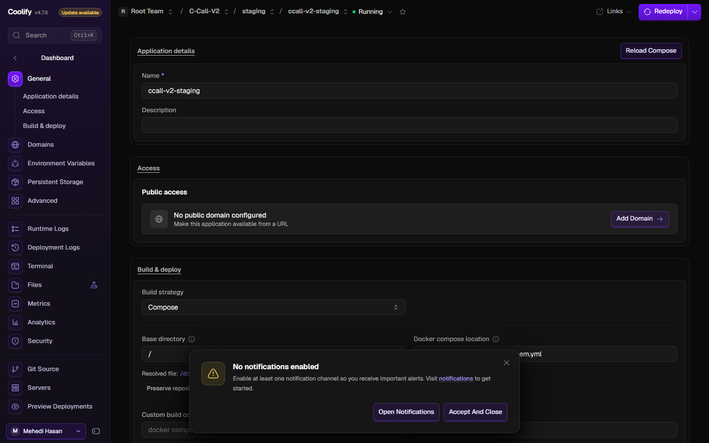
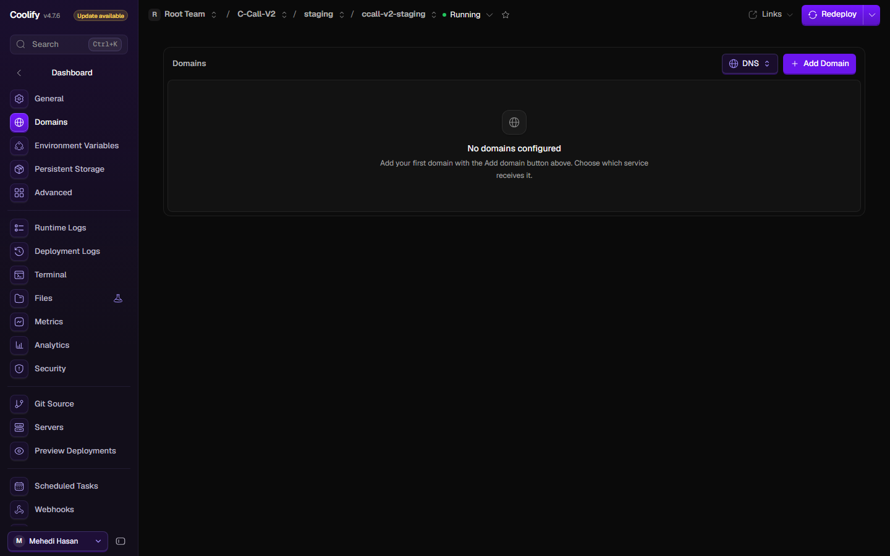
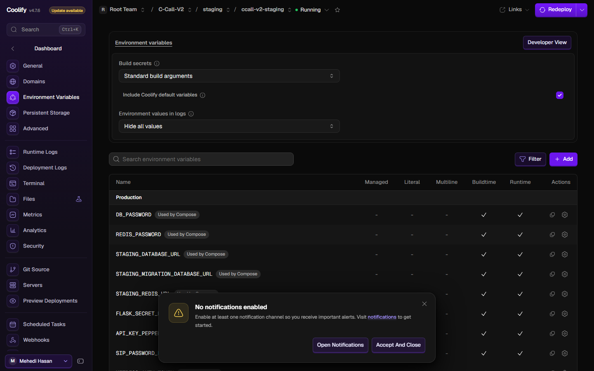

# C-Call V2 — Domain & Automatic SSL Setup Guide (Coolify)

Follow these exact steps when you are ready to attach your own domain (for example, `app.yourdomain.com` or `staging.yourdomain.com`) to C-Call V2 on Coolify (`169.40.116.43`) with automatic Let's Encrypt HTTPS.

---

## Step 1: Create the DNS `A` Record

In your domain registrar or DNS provider (Cloudflare, Namecheap, Route 53, GoDaddy, etc.), add an **A record**:

| Type | Name / Host | Value / IPv4 Address | TTL | Proxy Status (if Cloudflare) |
| --- | --- | --- | --- | --- |
| `A` | `app` (or `@` for root domain) | `169.40.116.43` | Auto / `300` | **DNS Only (Grey Cloud)** during initial SSL issuance |

> **Important:** Wait 1–5 minutes and verify DNS propagation before configuring Coolify:
> ```bash
> nslookup app.yourdomain.com
> ```
> It must resolve to `169.40.116.43`.

---

## Step 2: Add the Domain in Coolify (Web Service, Port `5000`)

1. Open your Coolify application:
   `http://169.40.116.43:8000/project/yaqcaw5fbpwoxbabtmwhplrh/environment/muqowdounv1r9kysmmzsn48q/application/sjuzkuk5a3spilwmbhgdspf2`
2. In the left sidebar, click **Domains** (or click **Add Domain ->** under **General -> Access -> Public access**).



3. Select the **`web`** service (do **not** attach a public domain to `postgres`, `redis`, `scheduler`, `migrate`, or `call_worker`).
4. Enter your domain with the `https://` prefix and container port **`:5000`**:
   ```text
   https://app.yourdomain.com:5000
   ```
   *(If Coolify shows a separate **Port** field instead of `:5000` inline, enter `https://app.yourdomain.com` in Domain and `5000` in Port.)*



5. Click **Save**.

---

## Step 3: Enable Automatic SSL (Let's Encrypt via Traefik)

- Coolify's built-in **Traefik (`coolify-proxy`)** automatically requests and renews a **Let's Encrypt TLS certificate** whenever a domain starts with `https://` and its DNS `A` record points to `169.40.116.43` with ports `80` and `443` reachable.
- You do **not** need to edit Nginx or global Traefik config manually.
- On `169.40.116.43`, `coolify-proxy` is already listening on `0.0.0.0:80` and `0.0.0.0:443`.

---

## Step 4: Update Environment Variables & Restore Strict HTTPS Cookies

Open **Environment Variables** in Coolify for `ccall-v2-staging`:



Update these 3 variables:

| Variable | Old (Pre-TLS Staging) | New (HTTPS Production / Staging) |
| --- | --- | --- |
| `APP_URL` | `http://localhost:5050` | `https://app.yourdomain.com` |
| `SESSION_COOKIE_SECURE` | `false` | `true` *(or delete the override — default is `true`)* |
| `PREFERRED_URL_SCHEME` | `http` | `https` *(or delete the override — default is `https`)* |

Click **Save** on each changed variable.

---

## Step 5: Redeploy & Verify HTTPS

1. Click **Redeploy** (top-right button in Coolify) so `web` picks up the new `APP_URL`, `SESSION_COOKIE_SECURE=true`, `PREFERRED_URL_SCHEME=https`, and Traefik labels.
2. Wait for the deployment status to show **Running**.
3. Verify HTTPS and health endpoints from your browser or terminal:

```bash
curl -I https://app.yourdomain.com/health/live
curl -s https://app.yourdomain.com/health/ready
```

Expected output:
- `HTTP/2 200` (with a valid Let's Encrypt certificate)
- `{"status":"ok"}`

4. Open in your browser:
   - **Admin Login**: `https://app.yourdomain.com/auth/login` (redirects Super Admin to `/admin/dashboard`)
   - **Merchant Login**: `https://app.yourdomain.com/auth/login` (redirects Merchant to `/dashboard`)
   - **Merchant Registration**: `https://app.yourdomain.com/auth/register`

5. Verify in browser DevTools (**Application -> Cookies**) that the session cookie has `Secure` and `HttpOnly` flags checked.

---

## Troubleshooting SSL Issuance

- **Certificate shows self-signed / Traefik default cert:**
  1. Confirm `nslookup app.yourdomain.com` returns `169.40.116.43` (disable Cloudflare Orange Cloud proxy during initial issuance).
  2. Check Coolify proxy logs without restarting existing sites:
     ```bash
     docker logs coolify-proxy --tail 50 | grep -i acme
     ```
  3. Trigger **Redeploy** on `ccall-v2-staging` after DNS propagates.
