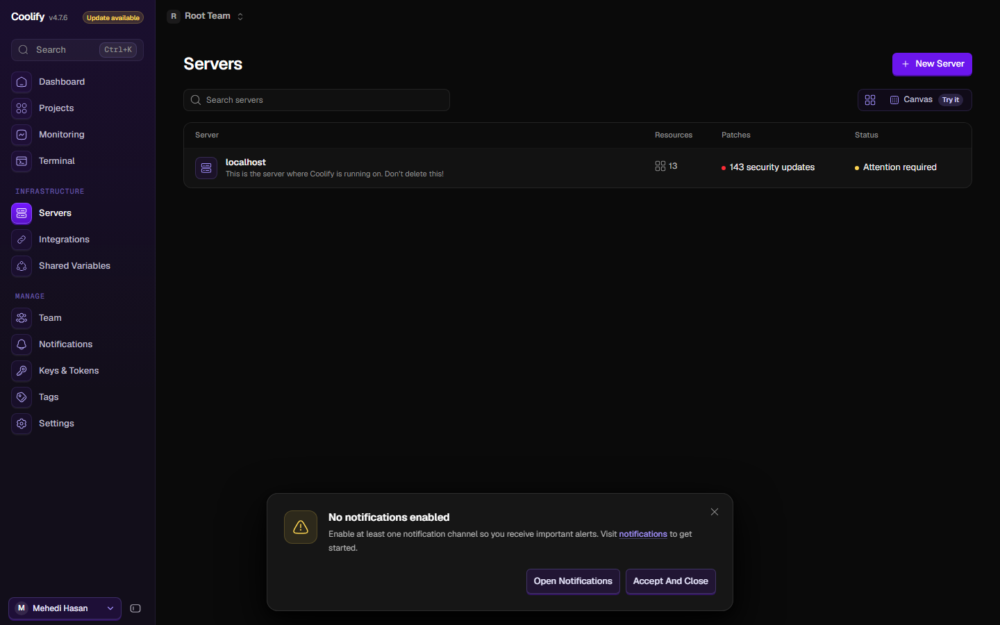

# C-Call V2 — Complete Self-Installation Guide

This beginner-friendly guide walks through installing **C-Call V2** independently on a fresh Ubuntu VPS or BDIX server using **Docker + Coolify** (recommended) or standalone Docker Compose.

---

## 1. Minimum Server Specifications (Based on Measured Usage)

Measured steady-state memory usage of the low-memory C-Call V2 staging stack (`docker-compose.staging.lowmem.yml`, 1 Gunicorn worker + 1 call worker):

| Container | Measured Idle RAM | Configured Cgroup Limit | Notes |
| --- | --- | --- | --- |
| `web` (Gunicorn) | ~87 MiB | `220M` | 1 worker, 2 threads |
| `scheduler` | ~92 MiB | `150M` | Retry & TTS reservation jobs |
| `call_worker` | ~65 MiB | `180M` | 1 worker, SIP/RTP + call monitor |
| `postgres` (16-alpine) | ~35 MiB | `160M` | `shared_buffers=32MB`, `max_connections=40` |
| `redis` (7-alpine) | ~3.5 MiB | `80M` | `maxmemory 48mb`, RDB-only |
| **Total C-Call Stack** | **~283 MiB** | **~790 MiB** | Build peak needs ~1.2–1.5 GiB |

### Recommended VPS Sizing

| Tier | CPU | RAM | Swap | Disk | Best For |
| --- | --- | --- | --- | --- | --- |
| **Minimum (Low-Mem / Staging)** | 2 vCPU | 2 GiB (dedicated) or 1 GiB free on shared host | 4 GiB swapfile | 20 GiB SSD | Staging, testing, low call concurrency (1–5 calls) |
| **Recommended (Production)** | 4 vCPU | 4 GiB | 2–4 GiB swapfile | 40 GiB NVMe | Production merchants (10–30 concurrent calls) |
| **Scale** | 6+ vCPU | 8+ GiB | 4 GiB swapfile | 80+ GiB NVMe | High concurrency + call recordings |

---

## 2. Ubuntu Server Prerequisites

Supported OS: **Ubuntu 24.04 LTS** (verified on `Ubuntu 24.04.4 LTS`, kernel `6.8.x`) or **Ubuntu 22.04 LTS**.

SSH into your server as `root` (or a `sudo` user):

```bash
apt update && apt upgrade -y
apt install -y curl git ca-certificates ufw openssl
```

### Add a 4 GB Swapfile (Recommended for <= 4 GiB RAM Hosts)

```bash
fallocate -l 4G /swapfile_ccall
chmod 600 /swapfile_ccall
mkswap /swapfile_ccall
swapon /swapfile_ccall
echo '/swapfile_ccall none swap sw 0 0' | tee -a /etc/fstab
free -h
```

---

## 3. Install Coolify (On a New Server)

If you are starting on a brand-new VPS and want Coolify to manage builds, SSL, and deployments:

```bash
curl -fsSL https://cdn.coollabs.io/coolify/install.sh | bash
```

Once installation finishes:
1. Open `http://<YOUR_SERVER_IP>:8000` in your browser.
2. Create your initial Coolify admin account.
3. Verify `localhost` shows as **Healthy** under **Servers**.

*(If you already have Coolify running on another server, skip this step and follow Section 4 to attach the new VPS as a remote server instead.)*

---

## 4. Connect an Additional Remote VPS / BDIX Server to Existing Coolify

You do **not** need to install Coolify twice. You can manage a second VPS or BDIX server from your existing Coolify dashboard:



1. In Coolify, go to **Keys & Tokens -> Private Keys** and copy Coolify's SSH public key (or create a dedicated SSH key).
2. On the new remote server, append that public key to `/root/.ssh/authorized_keys`:
   ```bash
   mkdir -p /root/.ssh && chmod 700 /root/.ssh
   echo "<COOLIFY_SSH_PUBLIC_KEY>" >> /root/.ssh/authorized_keys
   chmod 600 /root/.ssh/authorized_keys
   ```
3. In Coolify, open **Servers -> + New Server**.
4. Enter:
   - **Name**: e.g. `ccall-bdix-vps`
   - **IP Address**: `<NEW_SERVER_PUBLIC_IP>`
   - **Port**: `22`
   - **User**: `root`
   - **Private Key**: select the key from step 1.
5. Click **Validate Server & Install Docker Engine**. Coolify installs Docker + Traefik automatically on the remote server.

---

## 5. GitHub Repository, Branch & Compose File

| Setting | Value |
| --- | --- |
| **Repository** | `https://github.com/abcsoft/C-Call` |
| **Branch** | `feat/c-call-v2-production-foundation` |
| **Build Pack** | `Docker Compose` |
| **Low-Memory Compose File** | `/docker-compose.staging.lowmem.yml` |
| **Standard Production Compose File** | `/docker-compose.prod.yml` |

---

## 6. Generate Strong Secrets & Required Environment Variables

Run these commands on your workstation or server to generate fresh cryptographically random secrets (never reuse secrets across environments):

```bash
# Database & Redis passwords (alphanumeric — safe in URLs without escaping)
openssl rand -hex 20   # DB_PASSWORD
openssl rand -hex 20   # REDIS_PASSWORD

# Flask, API key pepper, metrics & backup passphrase
openssl rand -hex 32   # FLASK_SECRET_KEY
openssl rand -hex 32   # API_KEY_PEPPER
openssl rand -hex 24   # METRICS_AUTH_TOKEN
openssl rand -hex 24   # BACKUP_ENCRYPTION_PASSPHRASE

# Fernet 32-byte URL-safe base64 key for SIP password encryption
python3 -c "from cryptography.fernet import Fernet; print(Fernet.generate_key().decode())"
```

### Environment Variables Reference

| Variable | Example / Purpose |
| --- | --- |
| `DB_PASSWORD` | Password for `ccall_staging_app` PostgreSQL user |
| `REDIS_PASSWORD` | Password for Redis `requirepass` |
| `STAGING_DATABASE_URL` | `postgresql://ccall_staging_app:<DB_PASSWORD>@postgres:5432/ccall_staging` |
| `STAGING_MIGRATION_DATABASE_URL` | Same as `STAGING_DATABASE_URL` (or migration role URL) |
| `STAGING_REDIS_URL` | `redis://:<REDIS_PASSWORD>@redis:6379/0` |
| `REDIS_URL` | Same as `STAGING_REDIS_URL` |
| `FLASK_SECRET_KEY` | Signs session cookies & CSRF tokens (64-char hex) |
| `API_KEY_PEPPER` | Server-side pepper for merchant API key hashes |
| `SIP_PASSWORD_ENCRYPTION_KEY` | Fernet key used to encrypt SIP trunk passwords in Postgres |
| `METRICS_AUTH_TOKEN` | Bearer token for `/metrics` endpoint |
| `BACKUP_ENCRYPTION_PASSPHRASE` | GPG/OpenSSL passphrase for encrypted database backups |
| `FLASK_ENV` | `production` |
| `APP_URL` | `https://app.yourdomain.com` (no trailing slash) |
| `ADMIN_EMAIL` | `admin@yourdomain.com` (must use a valid public TLD — avoid `.local`) |
| `WEB_WORKERS` | `1` (low-memory) or `2`–`4` (production) |
| `WEB_THREADS` | `2` (low-memory) or `4` (production) |
| `CALL_WORKERS` | `1` (low-memory) or `2`–`4` (production) |
| `CALL_WORKER_BATCH_SIZE` | `1` (low-memory) |
| `CALL_WORKER_POLL_SECONDS` | `5` |
| `SIP_TRANSPORT` | `udp` |
| `SIP_BIND_IP` | `0.0.0.0` |
| `RTP_BIND_IP` | `0.0.0.0` |
| `SIP_ADVERTISED_IP` | `<YOUR_SERVER_PUBLIC_IP>` |
| `RTP_ADVERTISED_IP` | `<YOUR_SERVER_PUBLIC_IP>` |
| `SIP_PORT` | `5060` |
| `RTP_PORT_MIN` | `10000` |
| `RTP_PORT_MAX` | `20000` |
| `LOG_LEVEL` | `info` |

> **Pre-TLS HTTP Tunnel Override Only:** If you temporarily access staging over `http://localhost:5050` before attaching a domain, set `SESSION_COOKIE_SECURE=false` and `PREFERRED_URL_SCHEME=http`. Remove both (or set `true` / `https`) as soon as HTTPS is active.

---

## 7. PostgreSQL, Redis & Database Migrations

- **PostgreSQL (`postgres:16-alpine`)**: Automatically initialized on first boot with isolated volume `staging_postgres_data` and tuned memory settings (`shared_buffers=32MB`, `work_mem=2MB`, `max_connections=40`).
- **Redis (`redis:7-alpine`)**: Automatically initialized with `maxmemory 48mb`, `maxmemory-policy noeviction`, password authentication, and RDB snapshots (`--appendonly no`).
- **Migrations (`migrate` service)**: Runs `python migrations/run_migrations.py` automatically before `web`, `scheduler`, and `call_worker` start.

Verify all **28 migrations** succeeded:

```bash
PG_CONT=$(docker ps -q --filter "name=postgres")
docker exec "$PG_CONT" psql -U ccall_staging_app -d ccall_staging \
  -c "SELECT COUNT(*) AS applied_migrations FROM schema_migrations;"
```

Expected output: `28`.

---

## 8. Create or Reset the Super Admin Account

Migration seed data creates `admin@ccall.com.bd` (`role = super_admin`). Set a strong bcrypt (cost 12) password on your server:

```bash
WEB_CONT=$(docker ps -q --filter "name=web")
PG_CONT=$(docker ps -q --filter "name=postgres")

HASH=$(docker exec "$WEB_CONT" python -c "
import bcrypt, getpass
pw = input('Enter new Super Admin password: ')
print(bcrypt.hashpw(pw.encode(), bcrypt.gensalt(12)).decode())
")

docker exec "$PG_CONT" psql -U ccall_staging_app -d ccall_staging -c \
  "UPDATE users SET password_hash = '$HASH', role = 'super_admin', email_verified = true WHERE email = 'admin@ccall.com.bd' RETURNING id, email, role;"
```

> **Note:** Use a valid public TLD for admin emails (e.g., `admin@ccall.com.bd` or `admin@yourdomain.com`). Domains ending in `.local` are rejected by WTForms email validation on `/auth/login`.

---

## 9. SIP Gateway, Firewall & Domain Setup

- For Coolify step-by-step deployment, see [COOLIFY_DEPLOYMENT_GUIDE.md](COOLIFY_DEPLOYMENT_GUIDE.md).
- For DNS, domain, and automatic Let's Encrypt SSL setup, see [DOMAIN_SSL_SETUP_GUIDE.md](DOMAIN_SSL_SETUP_GUIDE.md).
- For SIP trunk setup, BDIX routing checks, and carrier-restricted SIP/RTP firewall rules, see [BDIX_SIP_CONFIGURATION_GUIDE.md](BDIX_SIP_CONFIGURATION_GUIDE.md).

---

## 10. Backup & Restore

### Manual Encrypted Backup

Using the built-in `backup` profile in `docker-compose.staging.lowmem.yml`:

```bash
cd /data/coolify/applications/<APP_UUID>
docker compose --profile backup run --rm backup
```

Or take an immediate `pg_dump` snapshot:

```bash
PG_CONT=$(docker ps -q --filter "name=postgres")
docker exec "$PG_CONT" pg_dump -U ccall_staging_app -Fc ccall_staging > ccall_staging_$(date +%F).dump
```

### Restore From a Dump

```bash
PG_CONT=$(docker ps -q --filter "name=postgres")
docker exec -i "$PG_CONT" pg_restore -U ccall_staging_app -d ccall_staging --clean --if-exists < ccall_staging_YYYY-MM-DD.dump
```

---

## 11. Updating the Application From GitHub

1. Push verified changes to `feat/c-call-v2-production-foundation` on GitHub.
2. Open your application in Coolify and click **Redeploy**.
3. Coolify pulls the latest commit, rebuilds the image, runs `migrate` (any new SQL migrations apply idempotently), and restarts `web`, `scheduler`, and `call_worker`.
4. Verify health:
   ```bash
   curl -fsS https://<YOUR_DOMAIN>/health/live
   curl -fsS https://<YOUR_DOMAIN>/health/ready
   ```

---

## 12. Common Errors & Troubleshooting

| Symptom | Cause | Fix |
| --- | --- | --- |
| `redis` crash-loop: `Can't open or create append-only dir appendonlydir: Permission denied` | Docker volume permissions conflict with `cap_drop: ALL` and AOF mode | Use `--appendonly no` + `cap_add: [SETUID, SETGID, DAC_OVERRIDE]` (already fixed in commit `4bd24a1`) and `chown -R 999:1000` on the Redis volume `_data` dir. |
| Login submits and stays on `/auth/login` with no redirect | `SESSION_COOKIE_SECURE=true` over plain HTTP (no TLS yet) | Attach HTTPS domain in Coolify (recommended), or temporarily set `SESSION_COOKIE_SECURE=false` and `PREFERRED_URL_SCHEME=http` while testing over HTTP tunnel. |
| Login shows `সঠিক ইমেইল এড্রেস লিখুন।` (invalid email) | Using `.local` email address (e.g. `admin@ccall.local`) | Use a valid TLD email such as `admin@ccall.com.bd` or `admin@yourdomain.com`. |
| `web` / `call_worker` stuck in `Created` state | Upstream `postgres`, `redis`, or `migrate` failed healthcheck | Check `docker logs <redis_or_migrate_container>` and resolve the dependency error first. |
| Out-of-memory (OOM) during Docker image build | Less than 1.5 GiB free RAM + swap | Add a 4 GiB swapfile (Section 2) and keep `WEB_WORKERS=1`, `CALL_WORKERS=1`. |
| SIP OPTIONS returns `404 Not Found` | Normal on Asterisk IP-PBX trunks when no extension is targeted | Check `REGISTER` in **Run SIP Diagnostic** — `REGISTER: 200 OK` confirms valid trunk connectivity and auth. |
